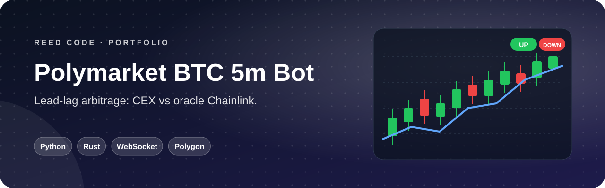
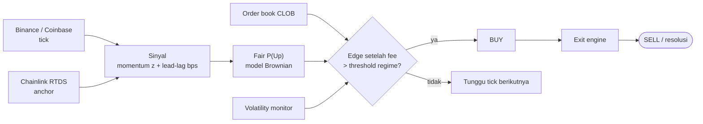

<p align="center">
  
</p>

<p align="center">
  <b>Membaca arah harga sebelum oracle bergerak.</b> Bot trading otomatis untuk market <i>BTC Up or Down, 5 Minutes</i> di Polymarket, dengan strategi lead-lag arbitrage antara bursa kripto dan Chainlink.
</p>

<p align="center">
  <a href="#sekilas">Sekilas</a> ·
  <a href="#kemampuan">Kemampuan</a> ·
  <a href="#cara-kerja">Cara Kerja</a> ·
  <a href="#mulai-menjalankan">Mulai Menjalankan</a> ·
  <a href="#konfigurasi">Konfigurasi</a> ·
  <a href="#deployment">Deployment</a> ·
  <a href="#disclaimer">Disclaimer</a>
</p>

<p align="center">
  
  <br>
  
  
  
</p>

## Sekilas

Market *BTC Up/Down 5m* diselesaikan berdasarkan harga **Chainlink** di setiap jendela 5 menit. Oracle diperbarui lebih lambat daripada harga di bursa (**Binance**, **Coinbase**) yang bergerak tiap tick. Bot ini mengukur jeda tersebut, menghitung peluang wajar arah harga, lalu masuk posisi saat order book Polymarket belum menyesuaikan.

## Kemampuan

<table>
  <tr>
    <td width="50%" valign="top"><b>📡 Feed Real-time</b><br>WebSocket Binance, Coinbase, Chainlink (Polymarket RTDS), dan order book CLOB.</td>
    <td width="50%" valign="top"><b>🧠 Multi-gate Entry</b><br>Momentum, lead-lag, likuiditas, batas odds, dan edge setelah fee harus lolos bersamaan.</td>
  </tr>
  <tr>
    <td valign="top"><b>🌡️ Volatility Regime</b><br>Threshold otomatis menyesuaikan kondisi pasar: <code>STEADY</code>, <code>CHOPPY</code>, atau <code>TURBO</code>.</td>
    <td valign="top"><b>🎯 Exit Asimetris</b><br>Cepat memotong rugi, menahan profit lebih lama. Dilengkapi <i>momentum shield</i>, <i>victory lock</i>, dan <i>trailing stop</i>.</td>
  </tr>
  <tr>
    <td valign="top"><b>🧾 Rekonsiliasi On-chain</b><br>Fill diverifikasi lewat perubahan saldo token, termasuk pemulihan <i>ghost fill</i> saat jaringan bermasalah.</td>
    <td valign="top"><b>🛡️ Manajemen Risiko</b><br>Batas rugi harian, sizing berbasis Kelly, dan cooldown setelah order gagal.</td>
  </tr>
  <tr>
    <td valign="top"><b>🦀 Rust Hot Path</b><br>Signing order dan HTTP pool di Rust (PyO3) untuk latensi rendah, dengan fallback otomatis ke Python.</td>
    <td valign="top"><b>🧪 Dry Run</b><br>Simulasi penuh tanpa uang sungguhan. Aktif secara default.</td>
  </tr>
</table>

## Cara Kerja



```text
fair_P_up = Φ( (ln(CEX_now / anchor) + drift) / σ )
edge      = fair_P_up × (1 − fee) − ask × (1 + fee)
```

<details>
<summary><b>Struktur project</b></summary>

<br>

| Path | Isi |
|---|---|
| `src/feeds/` | WebSocket Binance, Coinbase, RTDS Chainlink, CLOB + price aggregator |
| `src/signals/` | Momentum, lead-lag, mispricing |
| `src/strategy/` | Entry engine, exit engine, volatility monitor |
| `src/execution/` | Order executor & position tracker |
| `src/market/` | Klien CLOB Polymarket & discovery market |
| `src/risk/` | Risk manager & position sizing |
| `src/config/` · `src/utils/` | Settings dari `.env`, logger, ring buffer |
| `rust_executor/` | Ekstensi native: signer + HTTP pool |
| `run.py` · `verify_hft.py` | Entry point · cek ekstensi Rust |

</details>

## Mulai Menjalankan

> Butuh **Python 3.9+** dan wallet Polygon yang terhubung ke Polymarket. Untuk live trading, siapkan USDC dan MATIC.

```bash
git clone https://github.com/KyyStacy/polymarket-btc-arbitrage-bot.git
cd polymarket-btc-arbitrage-bot

python -m venv .venv
source .venv/bin/activate          # Windows: .venv\Scripts\activate
pip install -r requirements.txt

cp .env.example .env                # isi kredensial
python run.py                       # DRY_RUN=true secara default
```

<details>
<summary><b>Mengaktifkan Rust executor (opsional)</b></summary>

<br>

```bash
curl --proto '=https' --tlsv1.2 -sSf https://sh.rustup.rs | sh
pip install maturin
maturin develop --release           # compile ekstensi polymarket_hft
python verify_hft.py                # pastikan ekstensi terdeteksi
```

</details>

## Konfigurasi

`.env.example` memuat sekitar 100 parameter lengkap dengan komentar. Yang paling sering diubah:

| Variabel | Default | Fungsi |
|---|---|---|
| `PRIVATE_KEY` · `POLYMARKET_ADDRESS` | — | Wallet Polygon & deposit wallet Polymarket. **Jangan pernah di-commit** |
| `CLOB_API_KEY` · `CLOB_SECRET` · `CLOB_PASSPHRASE` | — | Kredensial CLOB API |
| `SIGNATURE_TYPE` | `3` | POLY_1271, satu-satunya mode yang didukung |
| `DRY_RUN` | `true` | Simulasi tanpa order sungguhan |
| `MIN_BET_USD` · `MAX_BET_USD` | `2.0` · `25.0` | Ukuran per trade |
| `MAX_DAILY_LOSS_USD` | `20.0` | Bot berhenti jika rugi harian melewati batas |
| `RISK_MAX_KELLY_FRACTION` | `0.25` | Fraksi Kelly maksimum |
| `ENTRY_WINDOW_START_SEC` · `ENTRY_WINDOW_END_SEC` | `60` · `270` | Rentang detik entry dalam jendela 5 menit |
| `EXIT_HARD_FLOOR_SEC` | `15` | Exit paksa menjelang resolusi |
| `VOL_CHOPPY_THRESHOLD` · `VOL_TURBO_THRESHOLD` | `4.0` · `7.5` | Batas skor antar-regime |
| `STEADY_*` · `CHOPPY_*` · `TURBO_*` | — | Threshold edge, momentum, dan lead-lag per regime |

Log ditulis ke `logs/bot.log` dan `logs/signals.log`. Tag utama: `[bot]`, `[exec]`, `[clob]`, `[vol-monitor]`.

## Deployment

Rekomendasi: **AWS `eu-west-1`** · `c6i.large` (2 vCPU, 4 GB RAM) · Ubuntu 22.04 · 20 GB gp3. Region ini dekat dengan `clob.polymarket.com` dan tidak terkena pembatasan wilayah.

<details>
<summary><b>PM2</b></summary>

<br>

```bash
npm install -g pm2
pm2 start run.py --name poly-bot --interpreter .venv/bin/python
pm2 logs poly-bot
pm2 save
```

</details>

<details>
<summary><b>systemd</b></summary>

<br>

```ini
# /etc/systemd/system/polybot.service
[Unit]
Description=Polymarket BTC Bot
After=network-online.target

[Service]
User=ubuntu
WorkingDirectory=/home/ubuntu/polymarket-btc-arbitrage-bot
ExecStart=/home/ubuntu/polymarket-btc-arbitrage-bot/.venv/bin/python run.py
Restart=always

[Install]
WantedBy=multi-user.target
```

```bash
sudo systemctl daemon-reload
sudo systemctl enable --now polybot
```

</details>

## Disclaimer

> **Untuk riset dan pembelajaran, bukan nasihat keuangan.** Trading prediction market berisiko tinggi dan kamu bisa kehilangan seluruh modal. Peluang mispricing bisa hilang kapan saja; latensi, slippage, gangguan oracle, dan risiko smart contract dapat menimbulkan kerugian. Pastikan penggunaan Polymarket legal di wilayahmu, dan selalu uji dengan `DRY_RUN=true` lebih dulu.

---

<div align="center">

<h2>Dibuat oleh Kyy Stacy × Reed Code</h2>

<p><i>Web & app developer: dari landing page sampai sistem bisnis custom.</i></p>

<a href="https://www.instagram.com/reedcode.id"></a>
<a href="https://www.tiktok.com/@reedcode.id"></a>
<a href="https://github.com/KyyStacy"></a>

<br><br>

<table>
  <tr>
    <td colspan="4" align="center"><b>Punya ide aplikasi atau butuh website untuk bisnismu?</b><br><sub>Reed Code siap bantu dari desain sampai online.</sub></td>
  </tr>
  <tr>
    <td align="center" width="25%">🌐<br><b>Company Profile</b><br><sub>Website brand & usaha</sub></td>
    <td align="center" width="25%">🛒<br><b>Toko Online</b><br><sub>Katalog & pembayaran online</sub></td>
    <td align="center" width="25%">📊<br><b>Sistem Bisnis</b><br><sub>Kasir, inventaris, booking</sub></td>
    <td align="center" width="25%">📱<br><b>Aplikasi Mobile</b><br><sub>Android & iOS</sub></td>
  </tr>
</table>

<a href="https://wa.me/6285171713355?text=Halo%20Reed%20Code%2C%20saya%20tertarik%20dengan%20jasa%20pembuatan%20website"></a>

<br><br>

<sub>© 2026 Kyy Stacy · Reed Code</sub>

</div>
